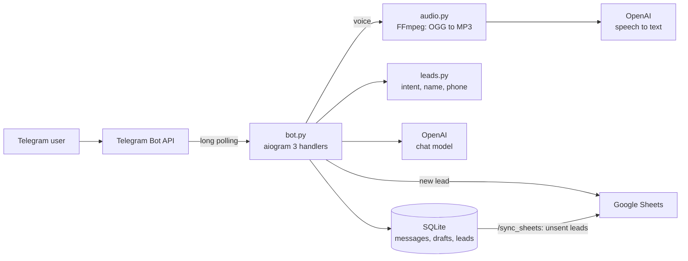

# AI sales assistant for Telegram

A Telegram bot that talks to potential clients about AI assistants for business, understands voice messages and collects leads (name and phone) into SQLite and Google Sheets. It started as an n8n workflow; this Python version runs on its own, without n8n.

## Features

- Replies through the OpenAI API (chat model from `.env`, `gpt-4.1` by default) and keeps the last 20 messages of each chat as context
- Voice messages: downloads the OGG/Opus file, converts it to MP3 with FFmpeg and transcribes it with `gpt-4o-mini-transcribe`
- Lead capture: notices order intent ("заказать", "заявка" and similar words), takes the name and phone from free text or a shared Telegram contact, and normalizes Kazakhstan numbers to `+7...`
- SQLite storage for chat history, lead drafts and leads
- Google Sheets export with retry: every lead is saved locally first, and leads that did not reach the sheet are sent again with `/sync_sheets` or `python sync_sheets.py`
- Commands: `/start`, `/reset` (clears the history and the lead draft), `/sync_sheets`, `/check_sheets`

## Architecture



## Run locally

You need Python 3.10+ and, for voice messages, FFmpeg in `PATH`.

```bash
python -m venv .venv
source .venv/bin/activate      # Windows: .venv\Scripts\activate
pip install -r requirements.txt
cp .env.example .env           # set TELEGRAM_BOT_TOKEN and OPENAI_API_KEY
python bot.py
```

The bot uses long polling and removes an old webhook on start. If the same bot ran in n8n before, turn that workflow off.

Google Sheets is optional:

1. Create a service account in Google Cloud and save its JSON key as `service_account.json`.
2. Share the spreadsheet with the service account email.
3. Set `GOOGLE_SHEETS_ENABLED=true`, `GOOGLE_SHEETS_SPREADSHEET_ID` and `GOOGLE_SHEETS_WORKSHEET` in `.env`.

Each lead becomes a row with the name, phone and Telegram ID.

## Configuration

| Variable | Default | Purpose |
| --- | --- | --- |
| `TELEGRAM_BOT_TOKEN` | required | bot token from `@BotFather` |
| `OPENAI_API_KEY` | required | OpenAI key |
| `OPENAI_CHAT_MODEL` | `gpt-4.1` | chat model |
| `OPENAI_TRANSCRIBE_MODEL` | `gpt-4o-mini-transcribe` | speech-to-text model |
| `DATABASE_PATH` | `data/bot.sqlite3` | SQLite file |
| `CONTEXT_WINDOW` | `20` | messages kept as context |
| `GOOGLE_SHEETS_ENABLED` | `false` | turns on the Google Sheets export |
| `GOOGLE_SHEETS_CREDENTIALS_FILE` | `service_account.json` | service account key |
| `GOOGLE_SHEETS_SPREADSHEET_ID`, `GOOGLE_SHEETS_WORKSHEET` | none, `Лист1` | target sheet |

## Project structure

```
bot.py                # aiogram handlers and polling
app/
├── config.py         # settings from .env
├── openai_service.py # chat and transcription calls
├── prompts.py        # system prompt and first message
├── audio.py          # voice download and FFmpeg conversion
├── leads.py          # order intent, name and phone parsing
├── storage.py        # SQLite: messages, lead drafts, leads
├── sheets.py         # Google Sheets client
└── sync.py           # resends leads that missed the sheet
sync_sheets.py        # CLI: resend unsent leads
check_sheets.py       # CLI: show the connected sheet and its last rows
```

## Author

Yerassyl Yermekov, junior Python / backend developer. Portfolio: [cv-yerassyl.vercel.app](https://cv-yerassyl.vercel.app/?lang=en) · Telegram: [@eeermekov](https://t.me/eeermekov)
